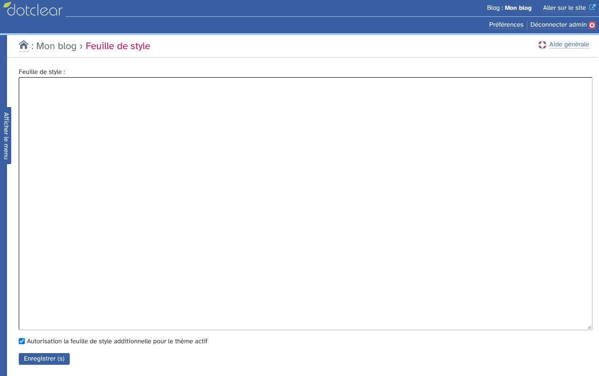
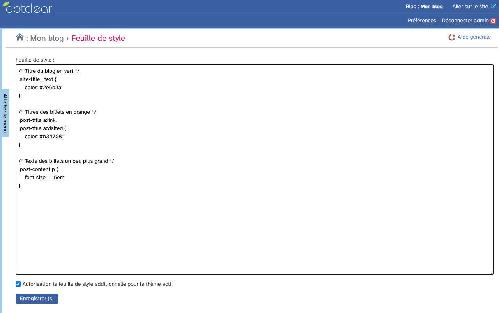
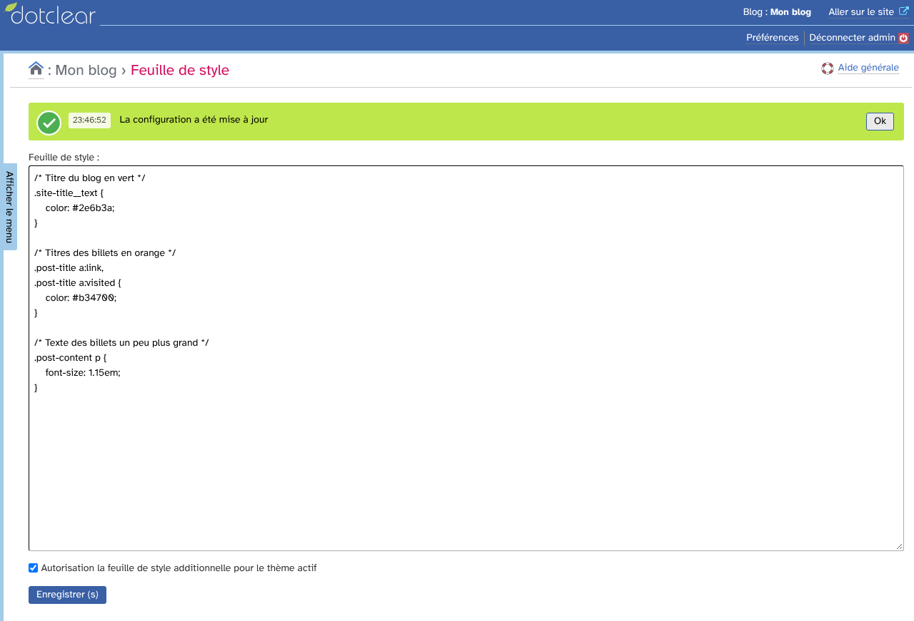
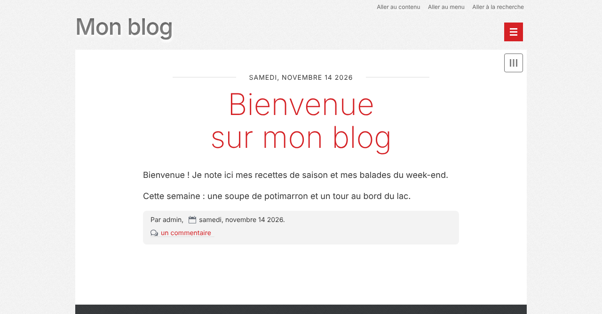
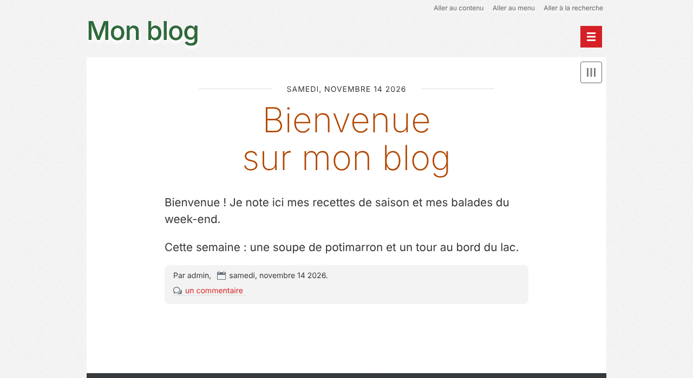

# moreCSS : guide d'utilisation

moreCSS ajoute vos propres règles de style (CSS) à celles du thème de votre blog.
Vous changez une couleur, une taille de texte ou un espacement sans modifier les fichiers du thème.
Vos règles restent en place quand le thème est mis à jour.

## Sommaire

* [Avant de commencer](#avant-de-commencer)
* [Écrire vos règles](#écrire-vos-règles)
* [Enregistrer et voir le résultat](#enregistrer-et-voir-le-résultat)
* [Quand une règle ne change rien](#quand-une-règle-ne-change-rien)
* [Désactiver sans effacer](#désactiver-sans-effacer)
* [Ce qu'il faut savoir](#ce-quil-faut-savoir)

## Avant de commencer

Ouvrez le menu « Blog », puis « Feuille de style ».
Le menu est réservé aux administrateurs et aux utilisateurs qui peuvent « gérer toutes les entrées et commentaires ».
Vous pouvez aussi ajouter l'icône de la page à votre tableau de bord, dans vos préférences, rubrique « Mes favoris ».

La page contient une grande zone de texte, vide au départ, et une case cochée.



## Écrire vos règles

Écrivez vos règles dans la zone « Feuille de style ».
Utilisez le langage CSS habituel.
Les commentaires entre `/*` et `*/` sont permis.

Voici un exemple pour le thème Berlin : il met le titre du blog en vert, les titres des billets en orange, et agrandit le texte des billets.

```css
/* Titre du blog en vert */
.site-title__text {
    color: #2e6b3a;
}

/* Titres des billets en orange */
.post-title a:link,
.post-title a:visited {
    color: #b34700;
}

/* Texte des billets un peu plus grand */
.post-content p {
    font-size: 1.15em;
}
```



Si la coloration syntaxique de l'éditeur de thème est active dans vos préférences (« Coloration syntaxique de l'éditeur de thème »), la zone de texte colore le code.

## Enregistrer et voir le résultat

Gardez la case « Autorisation la feuille de style additionnelle pour le thème actif » cochée.
Cliquez sur « Enregistrer (s) ».
La page affiche « La configuration a été mise à jour ».



Ouvrez ensuite votre blog.
Le changement est visible tout de suite, sans vider de cache.

Avant :



Après :



## Quand une règle ne change rien

Le thème écrit parfois sa propre règle sur un élément placé à l'intérieur de celui que vous visez.
Avec le thème Berlin, la règle `.site-title__link { color: #2e6b3a; }` ne change pas la couleur du titre du blog : la couleur est fixée sur `.site-title__text`, un élément à l'intérieur du lien.
Il faut viser cet élément, comme dans l'exemple ci-dessus.

Pour trouver le bon élément :

* ouvrez votre blog et inspectez le texte avec les outils du navigateur (clic droit, « Inspecter ») ;
* repérez l'élément qui porte la couleur ou la taille, par exemple `.site-title__text` ;
* écrivez votre règle avec ce sélecteur.

Quand le thème utilise un sélecteur plus précis que le vôtre, c'est sa règle qui gagne : recopiez alors son sélecteur.

## Désactiver sans effacer

Décochez la case « Autorisation la feuille de style additionnelle pour le thème actif », puis cliquez sur « Enregistrer (s) ».
Le blog n'utilise plus vos règles, mais le texte reste dans la zone.
Cochez la case pour les remettre en service.

Une zone de texte vide, avec la case cochée, n'ajoute rien non plus au blog.

## Ce qu'il faut savoir

* Les règles s'appliquent au thème actif du blog. Si vous changez de thème, la feuille reste en place, mais ses règles ne conviennent peut-être plus.
* Elles s'appliquent à l'écran, pas à l'impression.
* Le plugin réduit votre CSS avant de le servir : il retire les commentaires et les espaces inutiles. Deux effets à connaître : un espace avant `:` est retiré, donc `.menu :hover` devient `.menu:hover` (écrivez `.menu *:hover` à la place) ; et dans un texte entre guillemets, par exemple `content: "Attention : lisez"`, les espaces autour de `:`, `;` et `,` sont retirés.
* Chaque blog a sa propre feuille de style.
